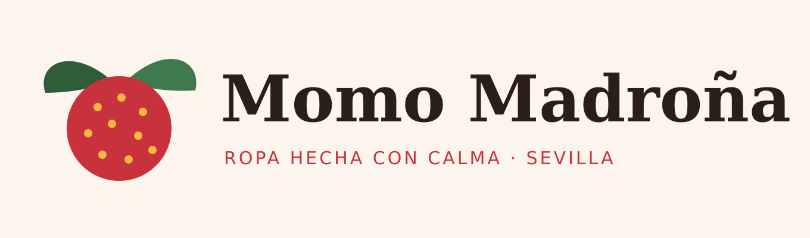

# Ficha de la empresa

> Todos los datos son **inventados** para la práctica. No corresponden a ninguna empresa real ni a datos míos.

## Quiénes somos

**Momo Madroña S.L.** es una marca de ropa de Sevilla que diseña y cose sus prendas en un pequeño taller del barrio. Hace ropa cómoda y de temporada con algodón orgánico y lino, en tiradas cortas y con colores sacados del madroño: rojo, verde hoja y crema.

Vende en su tienda-taller, a particulares, y también a tiendas pequeñas de otras ciudades que quieren tener la marca. Además hace arreglos y bordados personalizados.

| Dato | Valor |
|------|-------|
| Nombre comercial | Momo Madroña |
| Razón social | Momo Madroña S.L. |
| Sector | Textil y moda |
| Actividad | Diseño, confección y venta de ropa; arreglos y bordados |
| NIF (ficticio) | B00427351 |
| Dirección (ficticia) | Calle del Madroño, 12 · 41003 Sevilla (España) |
| Teléfono (ficticio) | 955 000 123 |
| Correo | hola@momomadrona.es |
| Web | www.momomadrona.es |
| Moneda | Euro (€) |

## Imagen de marca

| Elemento | Valor |
|----------|-------|
| Color principal | Rojo madroño `#C8323C` |
| Color secundario | Verde hoja `#2F5D3A` |
| Color de fondo | Crema `#FBF5EE` |
| Logo | Fruto de madroño con dos hojas ([logo.svg](logo.svg) / [logo.png](logo.png)) |
| Lema | *Ropa hecha con calma* |

## Cómo lo he configurado en Odoo

**Ajustes → Compañías → Momo Madroña S.L.**: nombre, logo, dirección, teléfono, correo, web y NIF.

**Ajustes → Compañías → Configurar el diseño del documento**:

- Plantilla: **Bold**
- Fuente: **Lato**
- Colores: `#C8323C` (principal) y `#2F5D3A` (secundario)
- Lema de la empresa (cabecera): *Ropa hecha con calma*
- Pie de página: *Momo Madroña S.L. · NIF B00427351 · Calle del Madroño 12, 41003 Sevilla · hola@momomadrona.es · www.momomadrona.es*

## Catálogo

| Referencia | Producto / servicio | Tipo | Precio de venta | Coste | Impuesto | Stock inicial |
|------------|---------------------|------|----------------:|------:|----------|--------------:|
| MM-CAM01 | Camiseta «Madroño» de algodón orgánico | Bienes (con seguimiento de stock) | 24,90 € | 9,00 € | IVA 21 % | 150 uds |
| MM-SUD01 | Sudadera «Momo» con bordado | Bienes (con seguimiento de stock) | 49,90 € | 21,00 € | IVA 21 % | 60 uds |
| MM-PAN01 | Pantalón de lino «Alameda» | Bienes (con seguimiento de stock) | 39,90 € | 16,00 € | IVA 21 % | 40 uds |
| MM-ARR01 | Arreglo y ajuste a medida | Servicio | 12,00 € | 5,00 € | IVA 21 % | — |
| MM-BOR01 | Bordado personalizado (nombre o inicial) | Servicio | 8,00 € | 3,00 € | IVA 21 % | — |

Cada producto tiene su foto en Odoo. Las tres prendas las he marcado para que Odoo lleve el control del stock y les he puesto la cantidad inicial desde **Inventario → Productos → Actualizar cantidad**.

## Clientes

| Cliente | Tipo | NIF (ficticio) | Dirección (ficticia) | Correo |
|---------|------|----------------|----------------------|--------|
| Concept Store El Patio Azul S.L. | Empresa | B00918264 | Calle Azulejo, 8 · 41004 Sevilla | compras@elpatioazul.example |
| Lucía Montero Vidal | Particular | 00000014Z | Calle Azucena, 3, 2.º B · 41010 Sevilla | lucia.montero@example.com |

El Patio Azul es una tienda pequeña que vende marcas locales y quiere tener la colección de Momo Madroña. Lucía es una clienta de la tienda-taller que suele encargar arreglos y bordados.
